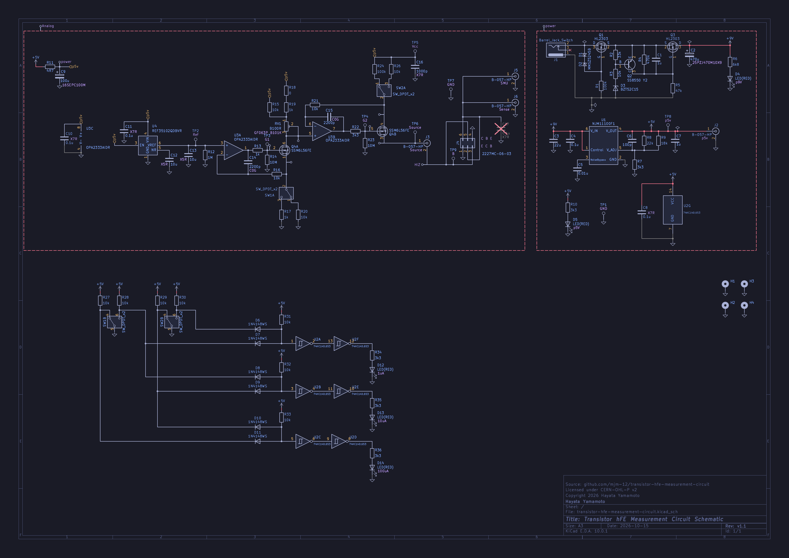

# Transistor hFE Measurement Circuit

Constant-current based circuit for measuring transistor hFE (KiCad project).

- v1.0: as ordered on 2026-07-02 (tag `v1.0`)
- v1.1: current revision (tag `v1.1`)

## Schematic

PDF: export from `transistor-hfe-measurement-circuit.kicad_sch` in KiCad 10.

## License

Copyright 2026 Hayata Yamamoto.

This hardware design is licensed under the CERN Open Hardware Licence Version 2 - Permissive (CERN-OHL-P-2.0). See [LICENSE](LICENSE).
